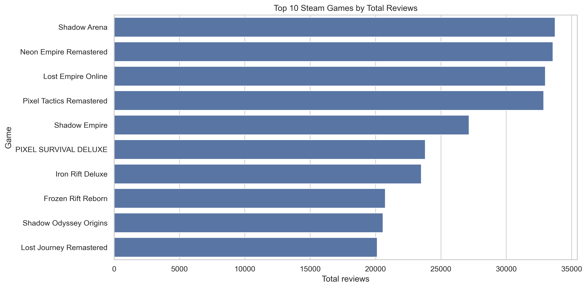

# STEAM INSIGHT

### A Data Analysis Project on Steam Games, Player Reviews, Pricing, and Engagement

## 1. Project Introduction

**STEAM INSIGHT** is an exploratory data analysis project that
investigates Steam games through their pricing, player reviews,
estimated ownership, genres, release dates, and playtime.

The goal is to transform a messy raw dataset into a cleaned,
analysis-ready dataset and use Python and SQL to identify patterns that
may help explain game popularity and player satisfaction.

## 2. Business Problem

Game developers and publishers need to understand how players respond to
games and which characteristics may be associated with stronger
engagement or satisfaction.

This project explores questions such as:

-   Which games receive the most player reviews?
-   Which games have the highest estimated ownership?
-   How does player satisfaction vary across games and genres?
-   Are free games and paid games different in review activity or
    satisfaction?
-   Which genres appear frequently in the dataset?
-   Which games have unusually high playtime?
-   Can games with strong player satisfaction but lower estimated
    popularity be identified?
-   Are price, playtime, review activity, and satisfaction related?

This is an exploratory project. The results show associations in the
dataset and do not establish that one factor causes another.

## 3. Dataset Description

The dataset contains Steam game records and the following original
columns:

  Column                       Description
  ---------------------------- -----------------------------------
  `name`                       Game title
  `release_date`               Game release date
  `estimated_owners`           Steam's estimated ownership range
  `price`                      Game price
  `positive`                   Number of positive reviews
  `negative`                   Number of negative reviews
  `average_playtime_forever`   Reported average playtime
  `genres`                     Game genre or genres

The raw dataset contains data-quality issues such as missing values,
duplicate records, inconsistent date formats, mixed price formats,
text-formatted review counts, and inconsistent genre separators.

## 4. Tools and Technologies

-   **Python** --- analysis workflow
-   **Pandas** --- data loading, cleaning, transformation, and analysis
-   **NumPy** --- numerical calculations and feature engineering
-   **Matplotlib** --- data visualization
-   **Seaborn** --- statistical visualizations
-   **SQL / SQLite** --- querying and business analysis
-   **Jupyter Notebook** --- interactive analysis and documentation

## 5. Data Cleaning Process

The raw dataset was inspected and cleaned using Pandas.

1.  Reviewed dataset dimensions, column names, data types, and
    missing-value counts.
2.  Investigated duplicate records and removed confirmed exact
    duplicates.
3.  Removed records with missing or blank game names where the game
    could not be identified.
4.  Standardized price values by removing currency symbols and text
    formatting, then converted prices to numeric values.
5.  Converted positive and negative review counts into numeric columns.
6.  Converted playtime values into numeric values while preserving
    unknown playtime as missing---not automatically treating it as zero.
7.  Standardized release dates into a consistent date format.
8.  Normalized genre text, separators, whitespace, and capitalization.
9.  Reviewed unusual values and retained missing values where a
    defensible replacement was unavailable.

Cleaning decisions should be documented alongside the notebook. Any
assumptions about currency or playtime units should be stated clearly.

**Cleaned dataset:** `steam_games_cleaned.csv`

## 6. Feature Engineering

The following analytical columns were created where the required source
values were available:

-   `total_reviews` --- positive reviews plus negative reviews.
-   `positive_rate` --- positive reviews as a percentage of total
    reviews.
-   `negative_rate` --- negative reviews as a percentage of total
    reviews.
-   `release_year` --- year extracted from the release date.
-   `price_category` --- Free, Budget, Mid-range, Premium, or Unknown.
-   `estimated_owners_midpoint` --- midpoint of the estimated ownership
    range; this is an approximation, not an exact sales count.
-   `game_performance_category` --- exploratory categories based on
    satisfaction and estimated popularity, with insufficient-data
    records separated.

The price-category thresholds used in this project are: Free = 0; Budget
= above 0 through 10; Mid-range = above 10 through 30; Premium = above
30. These thresholds assume prices are in USD and should be revised if
the dataset uses another currency.

**Enriched dataset:** `steam_games_enriched.csv`

## 7. Analysis Methodology

### Python analysis

The analysis uses Pandas and NumPy to calculate review totals, review
rates, summary statistics, genre-level summaries, and estimated
ownership comparisons.

### SQL analysis

The cleaned data was loaded into a SQLite table named `steam_games`. SQL
queries use:

-   `SELECT`, `WHERE`, `ORDER BY`, and `LIMIT`
-   `GROUP BY` and `HAVING`
-   `COUNT`, `SUM`, `AVG`, `MIN`, and `MAX`
-   `CASE WHEN`
-   Subqueries

A `JOIN` is not required for the current single-table dataset. It may be
added if the data is normalized into related game and genre tables.

### Interpretation

Review rate is used as a measure of review sentiment, not as a complete
measure of player experience. Review count and estimated ownership are
used as indicators of activity/popularity, with the limitations
described below.

## 8. Visualizations

Add the final charts produced by the notebook to the `visualizations/`
folder. Suggested figures include:

-   Top 10 games by total reviews
-   Top 10 games by estimated ownership midpoint
-   Overall positive versus negative review distribution
-   Game price-category distribution
-   Most common genres
-   Average positive review rate by genre
-   Top games by average playtime
-   Playtime versus positive review rate
-   Game performance-category distribution

Example image embedding after saving a chart:

``` {.markdown}

```

## 9. Key Findings

-   **Most reviewed games:**
-   **Estimated ownership:**
-   **Player satisfaction:**
-   **Genre comparison:**
-   **Pricing:**
-   **Playtime:**
-   **Hidden gems:**

## 10. Business Recommendations

Recommendations should be finalized based on the observed results.
Potential directions include:

-   Investigate highly reviewed games to understand features or
    community engagement associated with high review activity.
-   Examine genres with comparatively high satisfaction, while checking
    that each genre has enough games and reviews.
-   Review highly satisfied but less popular games as possible discovery
    or marketing opportunities.
-   Consider player feedback when evaluating pricing; do not infer an
    ideal price from correlation alone.
-   Treat unusually high playtime as an engagement signal and
    investigate the games' design or player communities.
-   Validate exploratory findings with more complete, recent, and
    representative data before making business decisions.

## 11. Limitations

-   The dataset is relatively small and may not represent all Steam
    games.
-   Estimated ownership is provided as a range; its midpoint is only an
    approximation.
-   Review counts and playtime may be incomplete, delayed, or measured
    differently across records.
-   Review sentiment is based on positive and negative review counts and
    does not capture review content or context.
-   Missing values may reduce the number of records used in individual
    analyses.
-   Genre values may contain multiple genres, and grouping by a full
    genre string can treat genre combinations as separate categories.
-   Price thresholds assume USD and are project-defined.
-   The data is observational; correlations do not prove causation.
-   Findings may change as games receive more reviews, owners, or
    playtime.

## 12. Project Structure

``` {.text}
STEAM_INSIGHT/
├── dataset/
│   ├── steam_games_messy.csv
│   ├── steam_games_cleaned.csv
│   ├── steam_games_enriched.csv
│   └── steam_insight.db
├── notebooks/
│   ├── 01_data_understanding.ipynb
│   └── 02_data_cleaning.ipynb
│   └── 03_feature_engineering.ipynb
│   └── 04_exploratory_analysis.ipynb
├── reports/
│   ├── hidden_gems.csv
│   └── sql_high_satisfaction_games.csv
│   └── sql_top_reviewed_games.csv
│   └── steam_data_quality_report.csv
│   └── steam_eda_summary.csv
│   └── steam_summary_statistics.csv
│   └── top_10_reviewed_games.csv
├── sql/
│   ├── steam_insight_queries.sql
    └── STEAM_INSIGHT_SQL.ipynb
├── visualizations/
│   └── game_performance_categories.png
│   └── genre_satisfaction.png
│   └── overall_review_sentiment.png
│   └── playtime_vs_satisfaction.png
│   └── price_category_distribution.png
│   └── top_10_owned_games.png
│   └── top_10_reviewed_games.png
│   └── top_genres.png
│   └── top_playtime_games.png
│   └── top_positive_rate_games.png
└── README.md
```

## 13. How to Run the Project

1.  Clone or download the project repository.

2.  Install the required libraries:

    ``` {.bash}
    pip install pandas numpy matplotlib seaborn jupyter
    ```

3.  Open Jupyter Lab or Jupyter Notebook.

4.  Run the notebooks in order, starting with data understanding and
    cleaning.

5.  Ensure the dataset paths in the notebooks match your folder
    structure.

6.  Run the SQL analysis after creating the SQLite database.

7.  Review the generated reports and visualizations.

## 14. Conclusion

STEAM INSIGHT demonstrates a complete beginner-level data analysis
workflow: inspecting raw data, cleaning it carefully, engineering
analytical features, exploring business questions with Python, querying
the dataset with SQL, and communicating results through visualizations
and documentation.

The project emphasizes transparent assumptions and responsible
interpretation of data.

------------------------------------------------------------------------

**Author:** Aakash Muthal

**GitHub:** https://github.com/AakashMuthal

**LinkedIn:** https://www.linkedin.com/in/aakash-muthal-36b453302/
